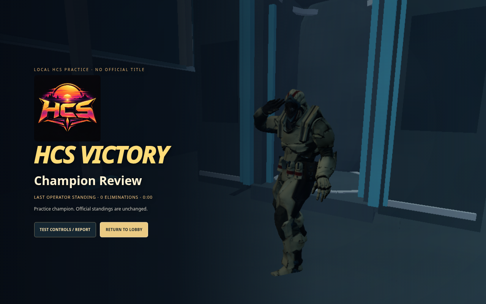
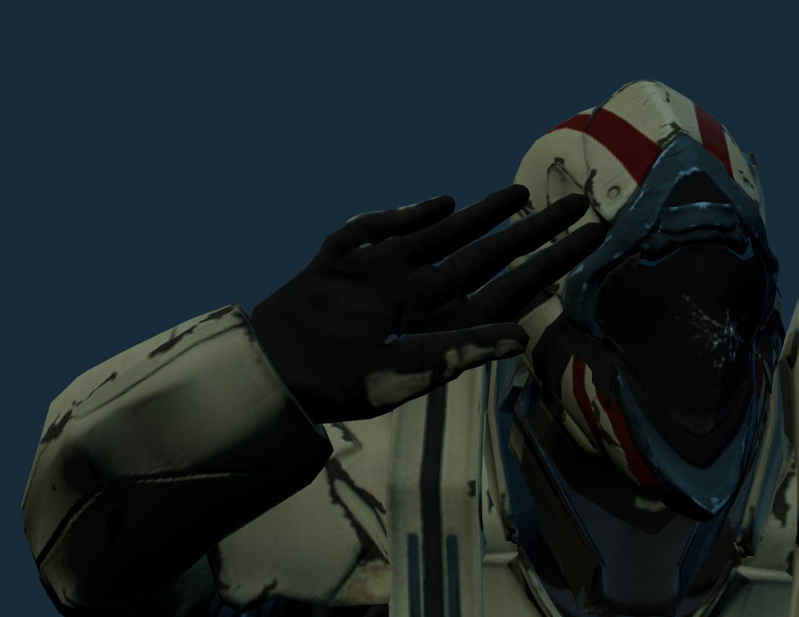
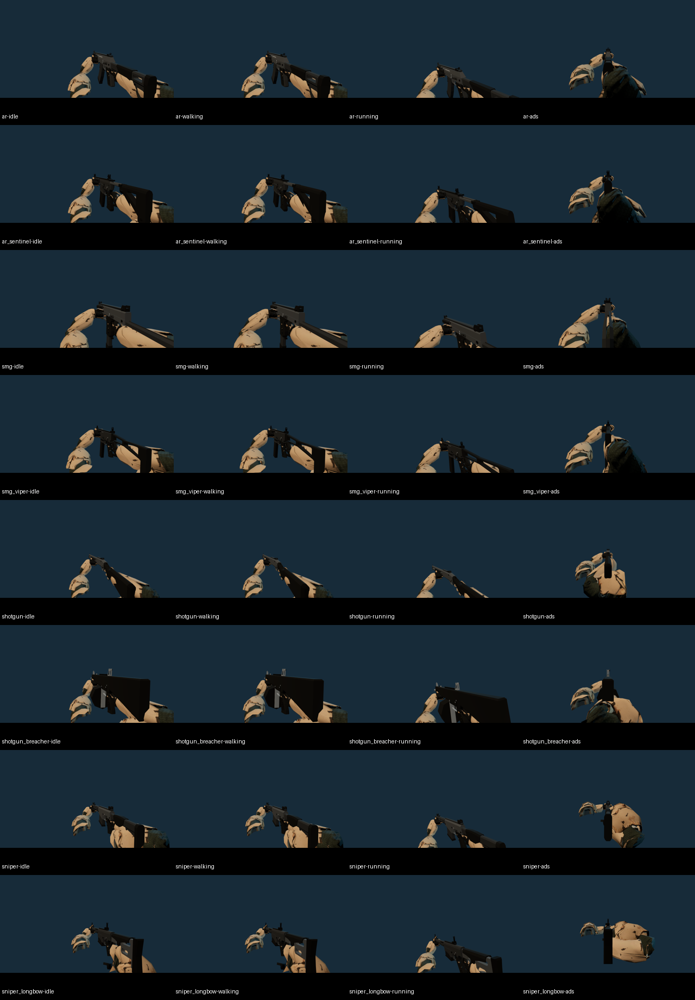
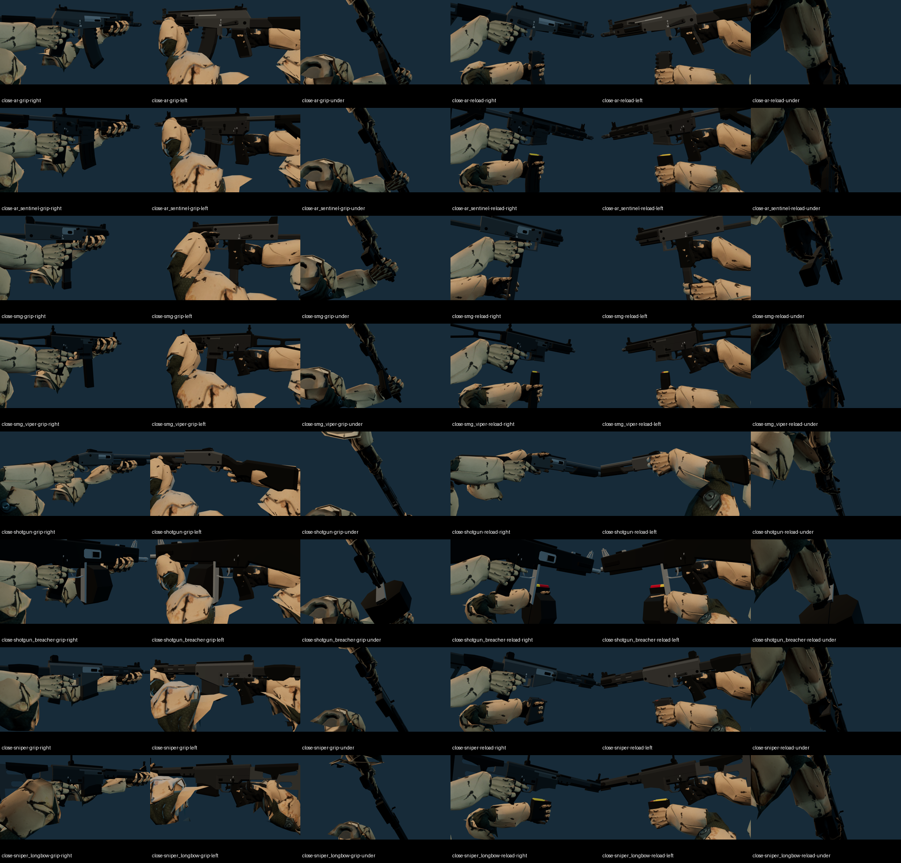
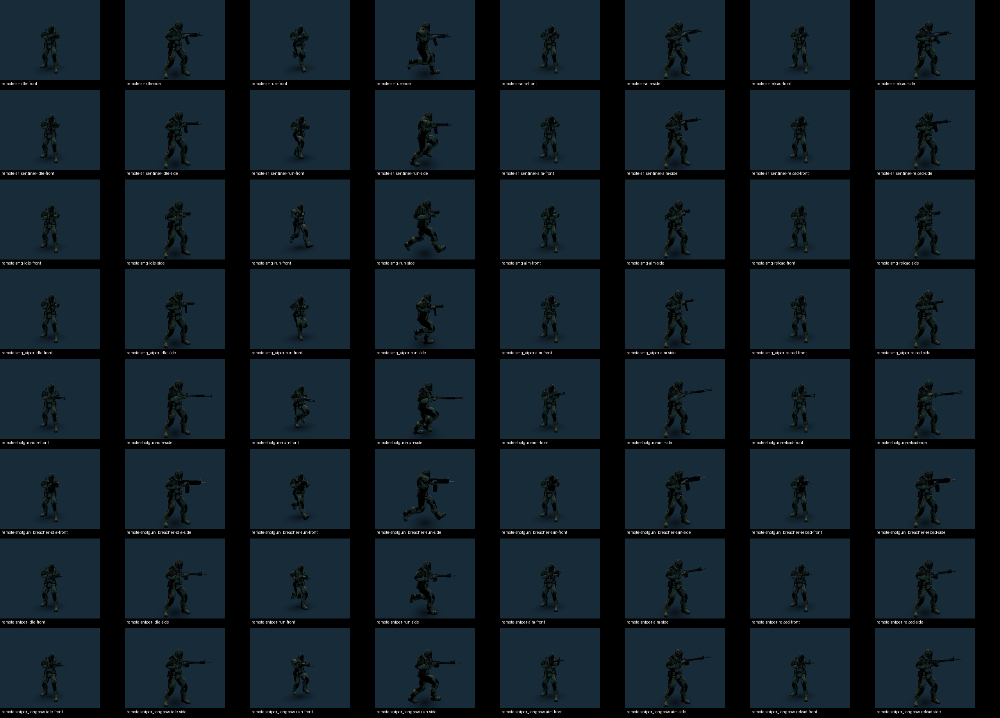

# Grip correction, full-hand salute and HCS rescue — 12 October 2026

This replaces the earlier HCS victory sequence and corrects the wrist-roll issue missed by the previous grip checks.

## What changed

The native forearm now follows the hand's palm frame instead of leaving 96–180° of axial twist at the wrist. First-person shoulders use the previous stance rather than the exaggerated sideways stance. Long ADS support reaches reserve some elbow flexion. The Thunder shotgun's stock grip was fitted against the shipped trigger and stock triangles; its firing palm and fingers now sit lower, with the trigger pad approximately 0.3 mm from the measured target. Weapon scale, native arm attachments and world aiming alignment remain intact.

All salutes use the same native full-hand pose in the lobby, normal deployment and HCS. The palm faces the front camera, all four fingers extend, the thumb rests against the index web, and small metacarpal adduction brings the actual glove edges together. Phalanx lengths stay unchanged. Those adduction offsets are restored before ordinary animation and weapon holding.

HCS now shows the rescue directly on the current map, without an immediate black screen. A closed pod descends and lands in front of the operator with a ground burst. Its doors open, the winner enters automatically, and it seals and boosts upward. The song starts during the ascent and black transition. The capsule rises through the existing spaceship's floor hatch on the song's beat drop, opens, and the champion walks out into a full-hand salute before the championship card appears. The final camera stays clear of neighbouring pods.

An indoor finish uses a nearby verified outdoor pickup shot so the capsule cannot descend through a roof. Placement checks include supported ground, capsule clearance, the upward flight column and the boarding path. The authoritative finished match and official standings are not modified by these presentation poses.

## Game-rendered screenshots

| Sequence | Screenshot |
| --- | --- |
| Rescue descends on the map | [Arrival](01-rescue-arrival.png) |
| Closed pod lands in front of the operator | [Touchdown](02-pod-landed.png) |
| Winner walks into the pod | [Boarding](03-walk-in.png) |
| Sealed capsule boosts upward | [Launch](04-boost.png) |
| Black transit while the song plays | [Transit](05-black-transit.png) |
| Capsule docks through the spaceship floor | [Spaceship arrival](06-ship-docking.png) |
| Doors open aboard the ship | [Opening](07-doors-open.png) |
| Unarmed winner walks out | [Exit](08-walk-out.png) |
| Held full-hand salute | [Salute](09-salute.png) |
| Championship screen | [Victory](10-champion.png) |
| Palm and packed fingers, close up | [Hand detail](salute-palm-close.png) |
| Full native operator pose | [Whole operator](salute-whole-hand.png) |
| Five-player test's delayed audience result | [Spectator result](full-06-delayed-champion.png) |





## Every weapon

Rows in each sheet are Striker AR, Sentinel AR, Raptor SMG, Viper SMG, Thunder Shotgun, Breacher Auto Shotgun, Eagle-Eye Sniper and Longbow Sniper.

The first-person sheet shows idle, walking, running and ADS. Individual full-resolution captures are in this directory, such as [Striker ADS](ar-ads.png), [Thunder ADS](shotgun-ads.png) and [Longbow running](sniper_longbow-running.png).



The contact sheet shows right side, left side and underside of each grip, followed by the same three views during reload. The 48 captures use actual weapon GLBs and the Soldier skin. Individual grip views are included, such as [Striker firing hand](close-ar-grip-right.png), [Striker opposite side](close-ar-grip-left.png) and [Thunder stock grip](close-shotgun-grip-right.png).



The peer sheet shows front and side views of idle, running, ADS and reload, for all eight guns.



## Verification and limits

- `npm run check`: syntax, 511 tests passed, zero failed or skipped, production build passed.
- Each weapon's existing 600-frame tests cover movement, recoil, sprint, ADS and reload transitions. Palm contact, trigger contact, finger contact and wrist bending limits pass.
- New checks measure axial wrist roll in all five first-person states and all five remote-player states. The remote fixture asserts that the actual selected weapon is rendered and both palms remain on their assigned contacts.
- The native salute checks show the palm at multiple character headings, keep the four fingers straight, measure contact between the real glove cross-sections, place the fingertip at the temple and verify cleanup into ordinary animation.
- 32 first-person state captures, 48 grip/reload close-ups and 64 peer views completed without browser errors.
- HCS stage captures use an injected fixed presentation clock to inspect the exact positions. The separate full test runs with the real clock: one controlled human operator, four native bots, two spectator windows, E boarding, original HCS deployment, combat, a scripted native practice result, the rescue/ship return, the real 20-second spectator delay and lobby cleanup. Bot fire is disabled for deterministic sequence verification; this is not an endurance combat benchmark.
- Native audio at 44.1 and 48 kHz preserves the supplied forward-playing excerpt. Eight cases passed; steady samples match the source, peak 0.539, no looping, fade to zero at the ending. Song begins 6.5 seconds into the rescue sequence; docking occurs at 10.95 seconds, corresponding to the 25.285-second bass drop. [Native timing sample](full-beat-sync.json) differed by approximately 0.000386 seconds from the projected audible clock. This does not measure physical speaker latency on every device.
- Supported finish positions sampled across the real Platform 23 collision map resolved to clear supported pickup locations. The HCS client fixture also passed selector, elimination, reconnect, cancelled-load, input-stability and champion-card checks.

Evidence: [weapon states](weapon-state-results.json), [close-up checks](close-results.json), [peer checks](peer-results.json), [salute checks](salute-results.json), [victory stages](victory-stage-results.json), [full HCS flow](full-results.json), [machine report](full-machine-report.json), [stock-grip fit](shotgun-fit.json).

The cloud browser uses SwiftShader software graphics, not an Apple M3 GPU. The full browser test uses local BroadcastChannel audience transport, not internet latency. The existing server/socket tests exercise multiplayer transport. Real Mac frame rate still needs a TEST LAB run on the target machine; the cloud screenshots and tests establish the rendered poses and sequence behaviour.

## Replay and reproduce

In the lobby, open **TEST LAB**, enter **12345**, and select **Full HCS** with its audience window enabled. Press **E** to board. Use **P** for controls and **Finish test final** to inspect the whole rescue and champion sequence. Practice does not award an official title or alter standings.

For development, run `PORT=4173 npm run dev`, then:

```sh
npm run test:weapon-states-browser
GAME_TEST_URL=http://127.0.0.1:4173 node scripts/grip-contact-check.mjs
GAME_TEST_URL=http://127.0.0.1:4173 GAME_POSES=idle,run,aim,reload node scripts/remote-grip-visual-check.mjs
npm run test:salute-browser
npm run test:hcs-victory-browser
npm run test:hcs-full-browser
GAME_TEST_URL=http://127.0.0.1:4173 npm run test:hcs-victory-audio
```
