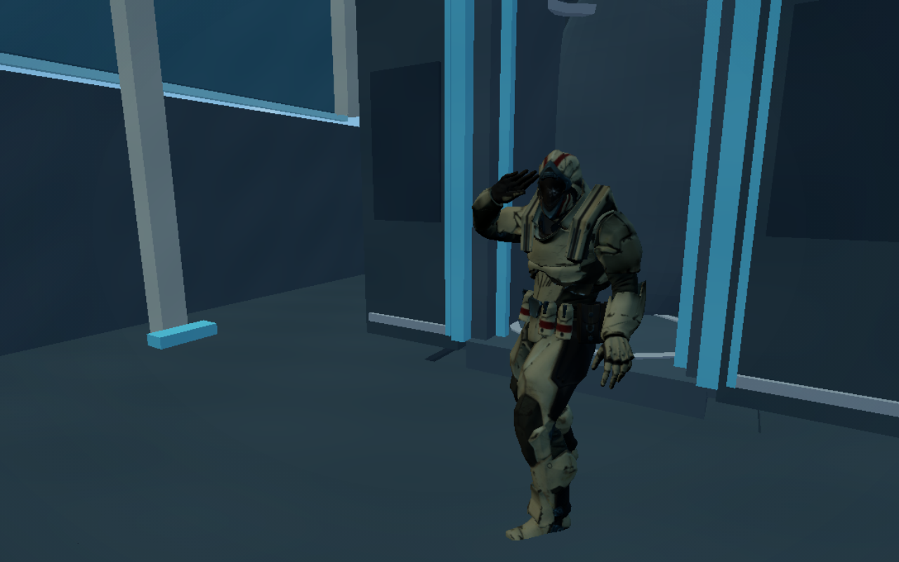

# HCS winner pod return — 15 October 2026

This corrects the scope of the 14 October change. **The song beat and sharp salute belong to the HCS winner’s pod return to the spaceship.** The start-game deployment, engine and authoritative simulation are restored byte-for-byte to revision `055854c`. Its original bass-drop landing and release timing remain intact. The [previous report](../salute-beat-2026-10-14/README.md) is historical and superseded.

The winner’s rescue, boarding, launch, docking and walkout keep their established pace. The winning excerpt now begins at song time 18.980 seconds when the pod launches, 6.500 seconds into the ceremony. The whole-hand salute raises in 200 ms and reaches its full pose on “Big” at 25.580 seconds, holding through “stepper” at 25.770. The camera pushes in on the 25.285-second bass hit, holds through the lyric and eases back. The original song continues forward across the championship screen, retaining its final 500 ms fade at 30.000 seconds.

| Ceremony time | Song time | Action |
| --- | --- | --- |
| 6.500 s | 18.980 s | Pod launches; winning music excerpt starts |
| 10.950 s | 23.430 s | Existing spaceship docking and hatch opening |
| 11.600 s | 24.080 s | Winner starts walking out |
| 12.805 s | 25.285 s | Camera beat accent begins |
| 12.900 s | 25.380 s | Sharp whole-hand salute raise begins |
| 13.100 s | 25.580 s | Full salute on “Big” |
| 13.290 s | 25.770 s | Full palm and close shot held through “stepper” |
| 14.050 s | 26.530 s | Championship screen appears; music continues |

## Native screenshots

[Salute on Big](winner-salute-on-big.png) · [Held salute on stepper](winner-salute-on-stepper.png) · [Pod return](pod-return.png)



These are actual native Soldier and spaceship captures from the winning-return controller, with no weapon in the champion’s hands. The timing fixtures capture the precise cue poses; the full local HCS run separately verifies natural playback through combat and victory.

## Checks

- Full project syntax, tests and production build pass: **542 tests, zero failures**.
- New tests first reproduced all four failures: wrong start-game changes, missing full HCS salute on the lyric, slow winning raise, and missing winning camera accent. All pass after the correction.
- Full local HCS with five operators (one browser-controlled player and four bots) and two delayed audience windows passes. It includes deployment, combat, the corrected winner return, championship screen, the actual 20-second result delay, clean lobby exit and rule checks. [Results](five-player-hcs-results.json).
- The native winning run records a full, weapon-free salute on the spaceship at song time **25.740 seconds**, 160 ms after the target lyric, within its measured 320 ms presented-frame interval. The camera accent reaches 1.0 and is still held through the following word. [Observed salute](victory-salute-sync.json).
- The native audio output clock and ceremony agree within approximately **1.34 ms** in the sampled launch frame. The source seeks forward when a frame arrives late, preserving the lyric’s position rather than restarting the excerpt. [Clock sample](native-clock-sync.json).
- Eleven native scene/cleanup checks pass, including rescue arrival, sealed boarding, launch and blackout, spaceship docking, exit, both lyric salute poses, championship display, and late-audio/lobby cleanup. [Scene results](scene-results.json).
- Eight native audio cases at 44.1/48 kHz pass: samples match original forward playback, peak amplitude is below 0.54, no loop, no clipping, correct final fade, and silence after the excerpt ends. [Audio results](native-audio-results.json).

The image captures were visually checked for the full operator, visible raised palm, grouped fingers, weapon-free pose and stable spaceship framing. The existing native whole-hand rig is unchanged.

## Limits

Chromium here renders through software GPU emulation, not an Apple M3 GPU. The 160 ms observed pose delay is reported rather than presented as perfect physical-device synchronization. Audio clock checks do not measure physical speaker latency. The five-player test uses local bots and BroadcastChannel audience transport; it does not prove production internet latency. Vercel/Northflank deployment status was not verified from this environment. Both need the same revision to restore the shared start-game timing.

## Reproduce

Serve the project on port 4173 and supply `GAME_TEST_URL=http://127.0.0.1:4173` for scripts whose default uses another port. Set `GAME_ARTIFACTS` to choose the capture folder.

```sh
npm run check
node scripts/hcs-full-test-check.mjs
node scripts/hcs-victory-browser-check.mjs
node scripts/hcs-victory-audio-check.mjs
```
