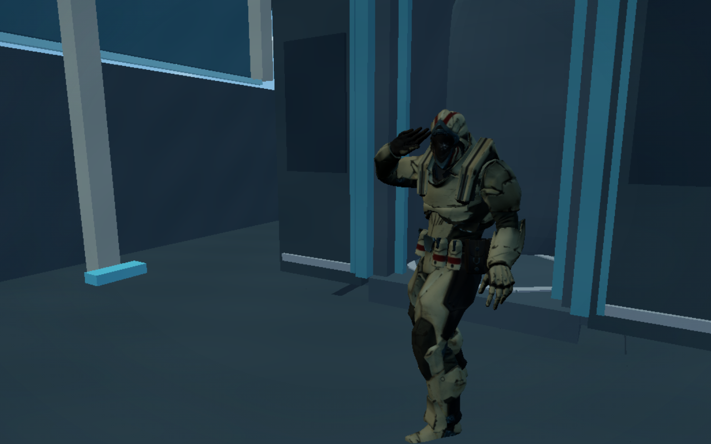

# HCS salute and camera sync — 17 October 2026 (Sydney)

The winner now starts raising the full hand on **“Big” (25.580 s)** and reaches the forehead on **“stepper” (25.770 s)**. The camera dolly and tighter framing peak with the completed salute. A small damped recoil follows the hit, then settles while the hand remains raised.

This updates the HCS **winner's return to the spaceship**. It supersedes the salute/camera timing in the [15 October report](../hcs-return-beat-2026-10-15/README.md). The original start-game deployment, normal gameplay camera, native hand/finger rig, audio samples and authoritative simulation are unchanged.

| Ceremony time | Song time | Salute and camera |
| --- | --- | --- |
| 12.900 s | 25.380 s | Walkout complete; feet planted |
| 13.100 s | 25.580 s | Raise begins on “Big”; camera starts tightening |
| 13.195 s | 25.675 s | Halfway through the raise and camera push |
| 13.290 s | 25.770 s | Full salute on “stepper”; closest framing |
| 13.335 s | 25.815 s | Small recoil while the hand stays raised |
| 13.990 s | 26.470 s | Camera settled; salute still held |
| 14.050 s | 26.530 s | Existing championship-screen deadline |

The lens tightens from 58° to 54° with a 9% dolly toward the champion, holds for 160 ms and settles over 420 ms. Recoil is deterministic and lasts at most 320 ms, with vertical amplitude bounded below 3.5 cm. The native rendered lens now follows the audible cinematic clock directly instead of passing through gameplay FOV smoothing. The 18.980 s music excerpt, 6.500 s launch, 10.950 s docking and final 500 ms audio fade remain intact. No new emitters, lights, assets or network messages were added.

## Actual renders

These are native Soldier/spaceship renders from the exact-cue fixture, not concept images. The full character and visible palm were checked through the raise, hit, recoil and settle.

[Big — raise begins](screenshots/big-raise.png) · [Half raise](screenshots/raise-mid.png) · [Stepper — full salute](screenshots/stepper-salute.png) · [Recoil](screenshots/camera-recoil.png) · [Settled](screenshots/settled-salute.png)



## Verification

- **560 tests passed**, zero failures/skips, plus syntax checks and production build. [Log](reports/unit-syntax-build.log).
- Cue tests first reproduced the old early full salute and early camera accent. The native fixture separately reproduced the rendered-lens smoothing delay before the fix. [Red cue tests](reports/red-cue-tests.log) · [Red lens check](reports/red-native-lens.log).
- **14 native scene/cleanup checks passed**. Controlled frames observe salute values 0, 0.5 and 1 at Big, the midpoint and stepper, with zero difference between requested and rendered FOV. [Results](reports/native-scenes.json).
- The continuous full HCS test passes ship boarding, original deployment, five-operator combat, winner return, championship screen, two actual 20-second-delayed audience windows and lobby cleanup. It uses one local player, four bots and two smaller rendered audience windows. [Results](reports/full-hcs.json).
- The first observed full salute in that run is at song time **25.874505 s**, with a measured **929.4 ms** interval around the observed hit. Peak camera accent is **1.000000**. Maximum requested/rendered lens difference over sampled native frames is **0.000000000 radians**. [Timing](reports/continuous-salute-sync.json).
- Native audio-clock comparison at the sampled launch frame differs by **180.373 ms**. The single source plays forward without looping. [Clock sample](reports/continuous-audio-sync.json).
- **8 audio cases at 44.1/48 kHz passed**: unchanged decoded samples, no looping/clipping, correct fade and silence after the excerpt. [Audio](reports/native-audio.json).
- **5 native whole-hand pose checks passed**, including palm orientation, different headings and mid-raise. [Hand checks](reports/native-hand-poses.json).
- Independent code review found no actionable issues. All 288 built public files match source, excluding deployment-generated config.

## Test diagnostics and limits

An initial full test missed the short live launch stage while waiting on browser commands, despite reaching the championship screen. The observer now retains actual rendered launch frames and their native audio timestamps; it does not rewind or force the animation, and keeps the same clock, offset, looping, visibility and delay assertions. [Initial timeout](reports/initial-full-test-timeout.log).

A subsequent three-full-size-window cloud run measured an approximately 850 ms frame gap and started the source at 19.669 s after seeking forward. That exceeded the test's unchanged 500 ms start-offset guard. [Assertion](reports/initial-full-test-offset.log) · [Native sample](reports/initial-delayed-clock-sample.json). The final test keeps the player's 1280×800 viewport and renders the two audience windows at 640×400 to reduce shared software-GPU load. The guard and all gameplay/delay assertions remain intact.

This host uses SwiftShader software rendering, not an Apple M3. Exact-cue fixture values are deterministic targets; the continuous timing above reports finite observed frame resolution. Existing lyric onsets have alignment uncertainty, and these checks do not measure physical speaker/display latency, production internet performance or a live Vercel rollout.

## Reproduce

```sh
PORT=4173 npm run dev
npm run check
GAME_ARTIFACTS=/tmp/hcs-scenes node scripts/hcs-victory-browser-check.mjs
GAME_ARTIFACTS=/tmp/hcs-full node scripts/hcs-full-test-check.mjs
GAME_TEST_URL=http://127.0.0.1:4173 GAME_ARTIFACTS=/tmp/hcs-audio node scripts/hcs-victory-audio-check.mjs
GAME_ARTIFACTS=/tmp/hcs-hand node scripts/full-hand-salute-check.mjs
```

Run browser checks sequentially on this software GPU. Start the preview in a separate terminal. No database migration, dependency or environment-variable change is required.
