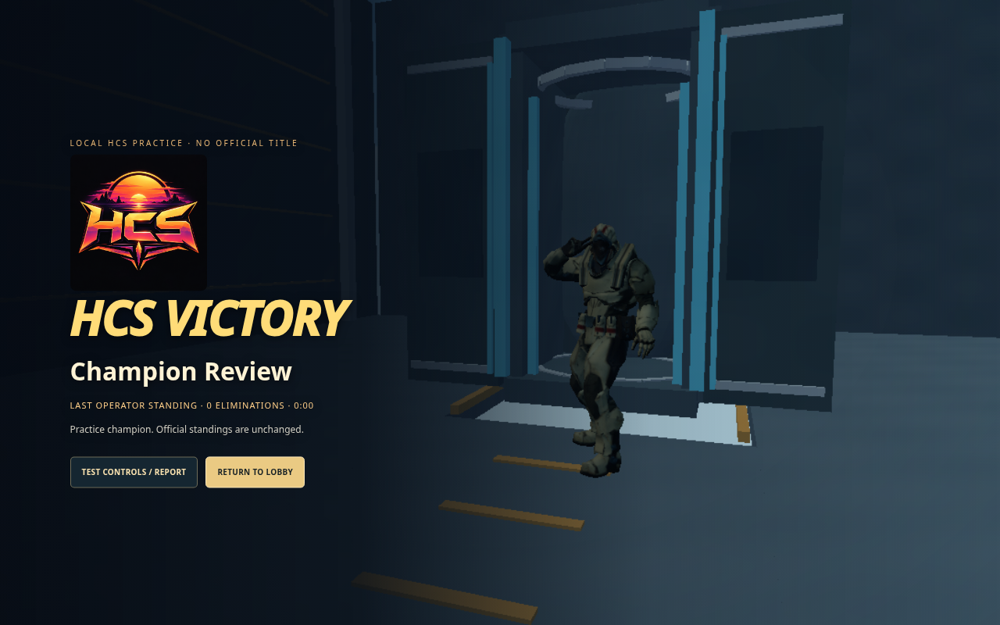
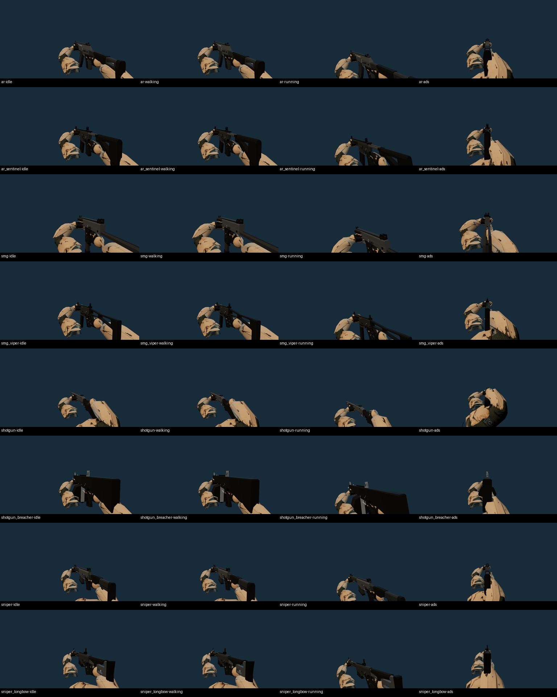

# HCS victory and weapon presentation — 12 October 2026

The champion sequence now fades immediately from the finished match to black, reveals an unarmed operator facing the pod, moves the camera closer, boards and seals the operator, launches the capsule through a retracting roof hatch, brings it back down, opens the doors, and shows the champion walking out into a held salute. The championship card, bounded confetti and fanfare follow the salute. Official matches and the full local HCS test use the same presentation.

The supplied song plays forward from 20.835 seconds, fading in over 0.2 seconds. Launch occurs on the 25.285-second drop. The return touches down on the 27.956-second bass onset. Lighting and pod accents pulse at the following measured onsets: 25.285, 26.415, 26.789, 27.956, 29.124 and 29.578 seconds. These were measured from the unchanged 30-second `deployment-intro.mp3` using its 40–160 Hz bass band; the existing deployment drop cue was preserved. The final 0.5 seconds fade out during the salute. There is one forward-playing source, without looping or cutting back to the start.

The camera, capsule, booster and light cues follow the AudioContext's audible output clock. Victory age travels inside the server snapshots, so spectators receive the same sequence through their existing 20-second delayed feed. Joining an already-running celebration seeks to its current point. Returning to the lobby cancels playback and removes the overlay. Reduced-motion settings show the final pose without the launch motion or confetti.

## Actual rendered captures

These are game-rendered screenshots, not concept images. The nine stage captures use a deterministic native `FinalMatch` result and controlled victory ages to inspect every camera position. The `full-*` captures below come from the complete local five-player test with two separate spectator windows.

| Stage | Screenshot |
| --- | --- |
| Black transition | [Black](01-black.png) |
| Operator faces the pod | [Reveal](02-pod-reveal.png) |
| Automatic boarding | [Walk in](03-walk-in.png) |
| Boost through the roof | [Launch](04-boost.png) |
| Descending capsule | [Return](05-return.png) |
| Open pod | [Doors open](06-hatch-open.png) |
| Unarmed champion exits | [Walk out](07-walk-out.png) |
| Held salute | [Salute](08-salute.png) |
| Final winning card | [HCS victory](09-champion.png) |
| Full test starts aboard the ship | [Five-player ship](full-01-hcs-ship.png) |
| Uploaded HCS emblem | [Deployment mark](full-02-hcs-emblem.png) |
| First-person combat | [Combat](full-04-hcs-combat.png) |
| Delayed audience champion card | [Spectator result](full-06-delayed-champion.png) |



## All eight weapon states

First-person ADS now preserves the weapon camera's field of view while the world camera performs its existing aiming zoom. Sprint carry has less roll and pitch. The native shoulder frame positions the elbows below the hands. Thunder's stock-grip ADS pose uses a lower right elbow to clear the rear sight. Palm anchors, trigger contact, finger calibration, weapon scale and native bone attachment lengths are preserved.

Every weapon was rendered and inspected in idle, walking, running and ADS. The ray test also confirms that no native sleeve intersects the centre sight ray during ADS. Existing 600-frame tests cover recoil, movement, ADS transitions and reloads for every weapon, including palm contact and wrist limits.

| Weapon | Idle | Walk | Run | ADS |
| --- | --- | --- | --- | --- |
| Striker AR | [Idle](ar-idle.png) | [Walk](ar-walking.png) | [Run](ar-running.png) | [Aim](ar-ads.png) |
| Sentinel AR | [Idle](ar_sentinel-idle.png) | [Walk](ar_sentinel-walking.png) | [Run](ar_sentinel-running.png) | [Aim](ar_sentinel-ads.png) |
| Raptor SMG | [Idle](smg-idle.png) | [Walk](smg-walking.png) | [Run](smg-running.png) | [Aim](smg-ads.png) |
| Viper SMG | [Idle](smg_viper-idle.png) | [Walk](smg_viper-walking.png) | [Run](smg_viper-running.png) | [Aim](smg_viper-ads.png) |
| Thunder Shotgun | [Idle](shotgun-idle.png) | [Walk](shotgun-walking.png) | [Run](shotgun-running.png) | [Aim](shotgun-ads.png) |
| Breacher Auto Shotgun | [Idle](shotgun_breacher-idle.png) | [Walk](shotgun_breacher-walking.png) | [Run](shotgun_breacher-running.png) | [Aim](shotgun_breacher-ads.png) |
| Eagle-Eye Sniper | [Idle](sniper-idle.png) | [Walk](sniper-walking.png) | [Run](sniper-running.png) | [Aim](sniper-ads.png) |
| Longbow Sniper | [Idle](sniper_longbow-idle.png) | [Walk](sniper_longbow-walking.png) | [Run](sniper_longbow-running.png) | [Aim](sniper_longbow-ads.png) |



Before-change comparisons: [Striker running](before-ar-running.png), [Striker ADS](before-ar-ads.png), [Thunder ADS](before-shotgun-ads.png), [Longbow running](before-sniper_longbow-running.png).

## Verification

- `npm run check`: syntax, all 503 tests, production build; no failed or skipped tests.
- All 32 native weapon-state screenshots; no browser errors.
- Native victory stage test: unarmed winner, opaque closed pod during flight, return, opening, exit, salute, champion card and cleanup; late-result seeking, input clearing without restarting music, cancellation on exit; no browser errors.
- Full HCS test: one controlled human operator plus four native bots, human E boarding, two password-gated spectator windows, existing HCS mark timing, deployment salute, combat, scripted native winner, final sequence, real delayed audience result, lobby cleanup, automatic audience creation and HCS rule checks. Bot firing is disabled for this deterministic sequence test; it is not an endurance combat benchmark.
- Native audio comparison at 44.1 and 48 kHz: eight victory-excerpt cases, zero difference from original samples at the configured steady gain, peak 0.539, zero output after the ending. Original deployment playback also passed its ten native audio regression cases.
- [Measured native cue comparison](full-beat-sync.json): approximately 0.000213 seconds between the sampled displayed cue and projected audible clock in this run. This is a software timing check, not a guarantee of physical speaker latency on every device.
- Official HCS client fixture: player selector, elimination, reconnect, cancelled load, input stability and final card.

Evidence: [stage checks](victory-stage-results.json), [weapon captures](weapon-state-results.json), [native audio](victory-audio-results.json), [full test checks](full-results.json), [machine report](full-machine-report.json).

The cloud uses headless Chromium with SwiftShader software graphics, not an Apple M3 GPU. The three-window full test recorded about 11.5 FPS, with simulation p95 around 1.4 ms and no graphics context loss. That software-rendering result cannot establish Mac frame rate or internet latency. The report's manual checkboxes remain unmarked; screenshot review and automated checks are documented separately here. Real multiplayer transport is covered by the existing server/socket tests; these browser audience windows use local BroadcastChannel transport.

## Reproduce

Start `PORT=4173 npm run dev`, then run:

```sh
npm run test:weapon-states-browser
npm run test:hcs-victory-browser
GAME_TEST_URL=http://127.0.0.1:4173 npm run test:hcs-victory-audio
npm run test:hcs-full-browser
```

On your Mac: open **TEST LAB** in the lobby, enter **12345**, choose **Full HCS**, and enable the audience window. Press **E** to enter your pod. Use **P** for test controls; **Finish test final** produces a native practice result so you can inspect the full victory sequence. The practice champion does not change official standings.
