# Platform 23 multiplayer loading recovery

13 October 2026, Sydney time. Actual Chromium screenshots from two party clients, not illustrations.

## Confirmed defect

Before the fix, an injected HTTP 503 for `collision-data.js` produced the reported map error. Clicking Ready again produced the same error with **only one collision-module request across both attempts**: Chrome cached the failed dynamic import. Resetting the loading promise did not clear that module failure.

Retries now use fresh module URLs after failure. Successful loads stay shared and cached. Map manifest, gzip geometry, textures and module requests have bounded retries/timeouts. Late textures from cancelled attempts are disposed. Both players finish map downloads and GPU preparation before advertising readiness, so the pod sequence cannot begin while a teammate is still loading.

Multiplayer match-start service errors are reported separately from map errors. A failed snapshot map load retains the newest snapshot, stops repeated loading on each incoming packet, and exposes **Retry Map** to resume the existing match.

## Automated checks

`npm run check` passed all **520 tests**, syntax checks and the static build. The authoritative HTTP/WebSocket tests now exercise **two and eight players on both maps**, including Platform 23 Town Royale. Seven focused loading tests cover bounded network/status/decode retries, permanent missing assets, stalled modules/textures and disposal of late abandoned textures.

## Browser evidence

`npm run test:map-loading-browser` exercises the actual lobby, map renderer, native collision and BroadcastChannel party transport:

- Three failed collision requests stop; the party remains in the lobby. The fourth request succeeds after Ready is pressed again, without reloading Chrome.
- Truncated manifest JSON, geometry HTTP 503 and a texture HTTP 503 each recover automatically on the next attempt.
- Both participants enter Platform 23 Town Royale and render its native ground and weapon models.
- A rematch adds **zero map downloads and zero shader compilations** (asserted against request and renderer counters).
- A simulated exhausted snapshot loader remains at one failed loading cycle despite incoming snapshots. Retry Map resumes the newest match without recreating the party.
- An injected match-service failure is not labelled as a map failure.

[Detailed recovery results](results.json)

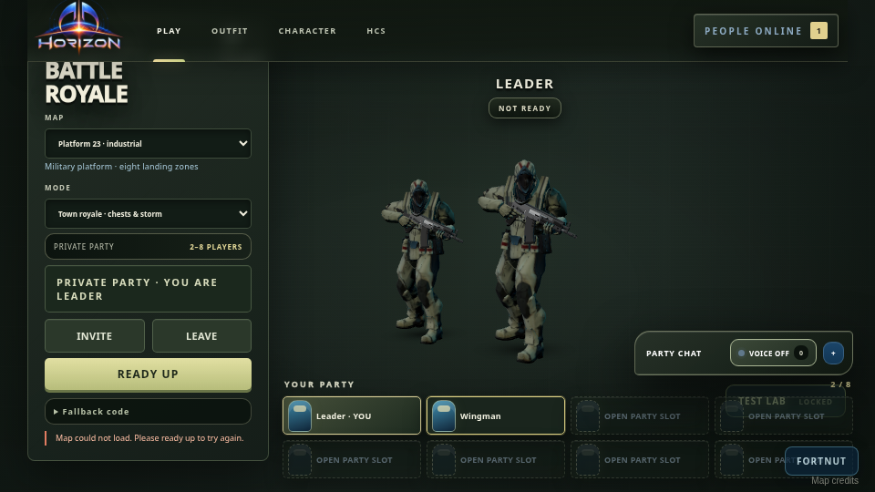
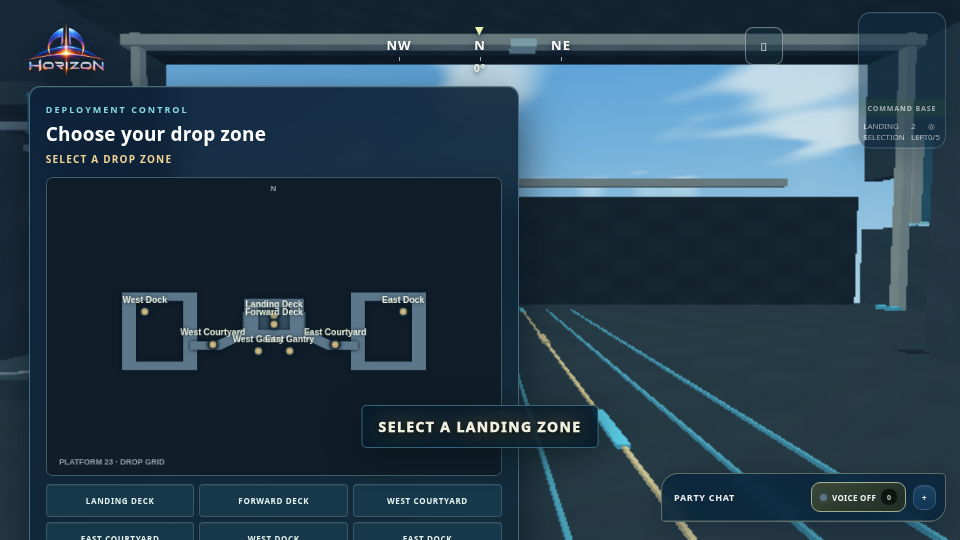
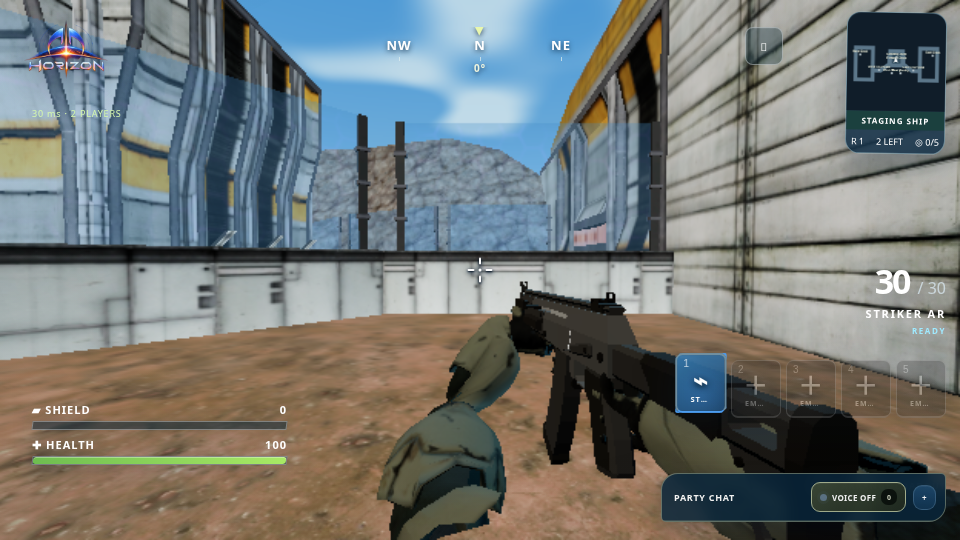
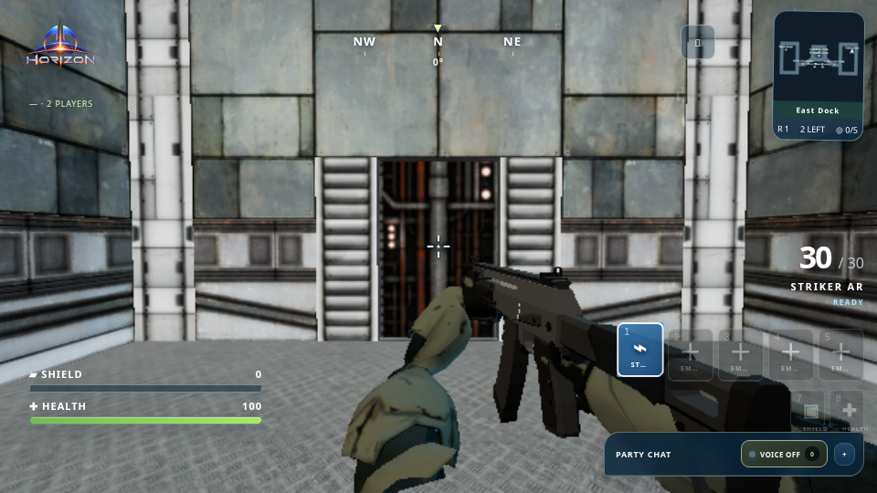

## Native deployment and gameplay follow-up

`npm run test:platform23-browser` passed 24 recorded checks, including real E boarding, two supported landing choices, touchdown/music timing, full-health return to play, supported-floor movement, remote knee-slide transitions, native chest interaction, weapon pickup/fire/audio, and map rendering. Browser runtime errors and WebGL errors were empty; no graphics context was lost in the whole-map, deck or room captures.

[Full native browser report](deployment-browser-results.json)

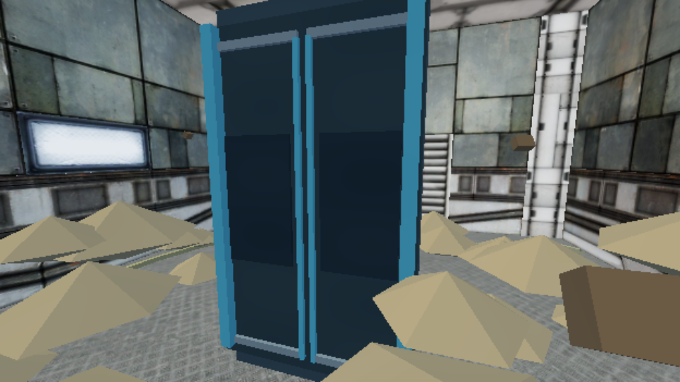
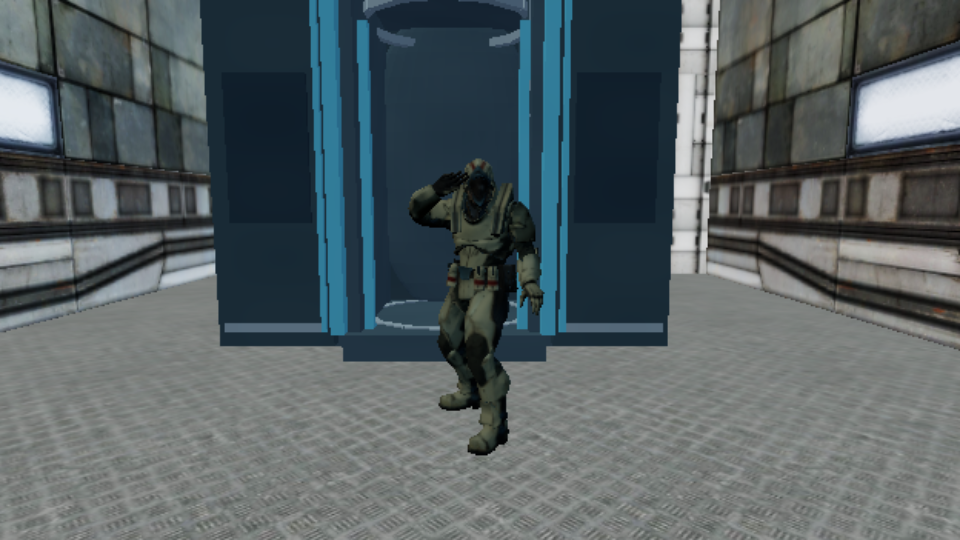
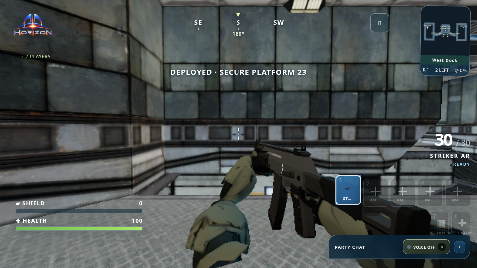
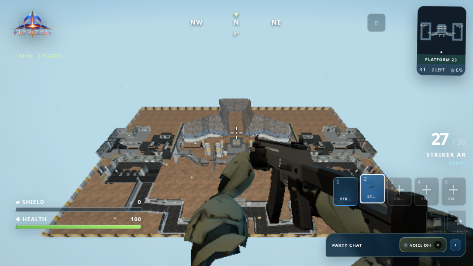
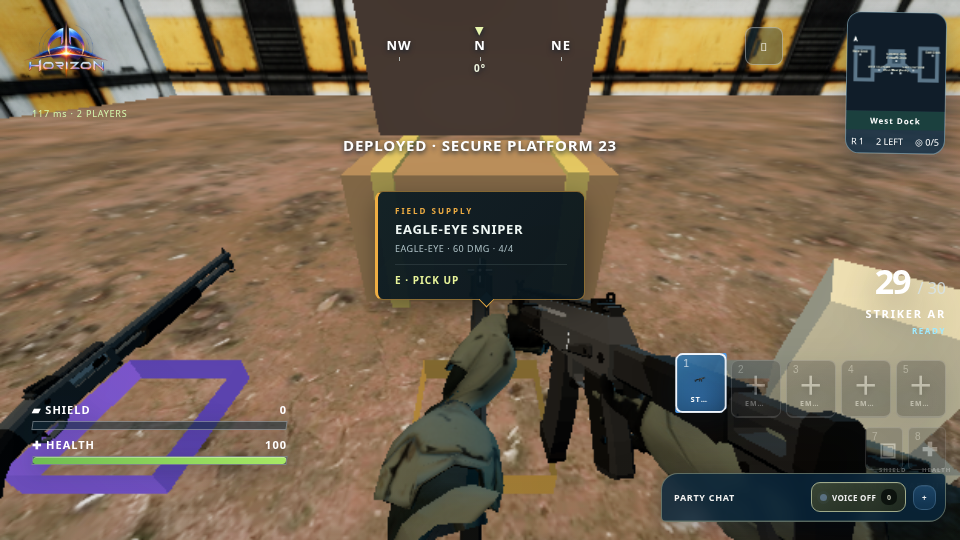

## Follow-up loading polish

The final polish passed **521 automated tests** and the static build. The Platform 23 recovery browser test was rerun successfully with the same six checks: [latest loading report](polish-loading-results.json).

`npm run test:map-loading-cancellation` passed seven additional real-lobby checks. Deferred boundary responses exercise leaving during Ready preparation, replacing a party, an old match-start response arriving late, and an old snapshot load completing during a new load. Only the current party's roster deploys; old completions neither alter its readiness nor clear its busy state. These cancellation fixtures use the shared lobby flow on Ironwood; the separate retry test exercises Platform 23's actual assets and renderer.

Loading controls now have a readable busy state and an unobtrusive activity bar, with reduced-motion support. Map, mode and identity controls stay locked during preparation. A focused fake-clock regression also confirms that a texture's own deadline controls timeout and disposal, without an earlier competing timer abandoning a valid texture.

[Cancellation and accessible UI results](cancellation-results.json)

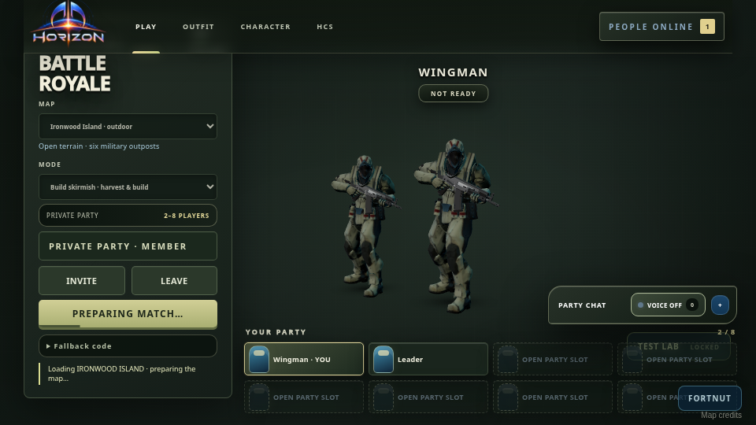
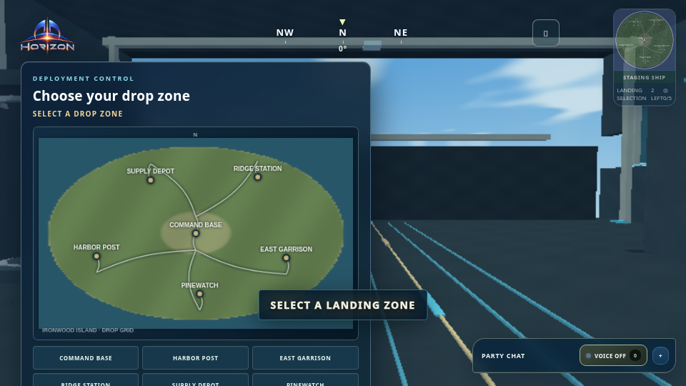

The native deployment captures and 24-check report above belong to the initial loading fix; the follow-up reran the loading/retry and cancellation suites. Map geometry, weapons, grips and cinematic behavior were not modified by this polish.

## Scope and limits

Authentication and roster authorization are fixtures in the authoritative server tests; the match server, HTTP, WebSocket transport and native map are real. The browser party test uses two local clients rather than two remote Macs. A separate boundary injection tests snapshot recovery after asset retries have been exhausted.

The cloud renderer is SwiftShader, not Apple M3 hardware. The background client missed the short camera handoff capture; the foreground client captured the full return, and the report records that software-rendering limit. The elapsed recovery time includes deliberate failures and test actions and is not a loading-speed benchmark. This workspace's network policy blocks direct Vercel and Northflank checks, so these results do not certify the deployed service or internet latency.

The deployment harness retains strict full-health, collision, animation and rendering assertions. Its brief movement-input probe now releases the key in the same browser task; it also brings the remote page back into view and follows the sliding operator before checking animation fade-out, because the game intentionally suspends rendering in hidden tabs and culls offscreen character animation.
