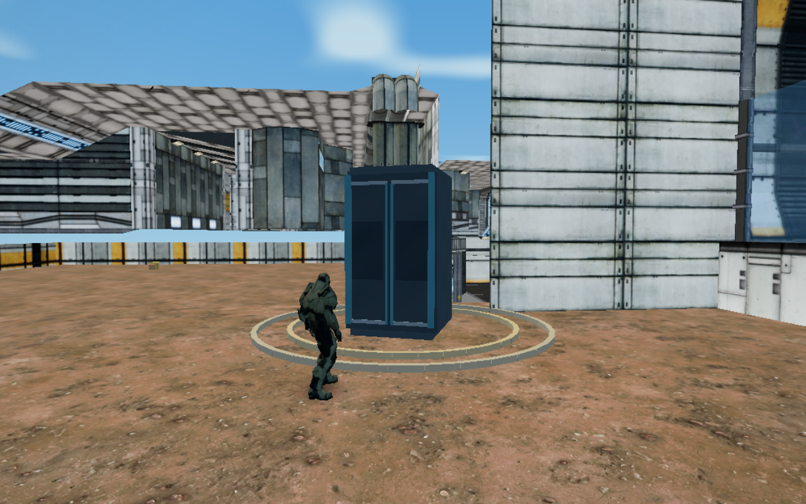

# Pod crash origin — 15 October 2026

The HCS rescue pod renders from an `[x,y,z]` position. Its debris generator and shockwave renderer expected an `{x,y,z}` destination. This produced invalid particle coordinates, which the reusable pool converted to zero: the crash debris appeared at the world origin instead of beneath the pod.

Both crash effects now use the same validated landing-position conversion. Arrays and objects produce identical bursts, and invalid positions skip the effect rather than falling back to zero. The normal deployment's existing object coordinates still work. Music, camera choreography, salutes and game rules are unchanged.

- Full syntax, production build and **545 tests pass**, including three new regression tests first observed failing.
- The native HCS winning-scene check passes through arrival, impact, boarding, launch, return, salute and audio/lobby cleanup.
- A test-only observer records the actual reusable pool's coordinates after its normal copy operation; it does not modify particles. **80 native particles** start around the rendered pod at `[-39.100972, 1.5, 15.405626]`. Every horizontal offset is below 1.4 m, with a measured maximum of **1.396631 m**. [Recorded positions](impact-origin.json).
- The actual native screenshot was checked for the shockwave centred around the landed capsule; particle birth positions are recorded separately in the pool probe. [Screenshot](02-pod-landed.png) · [Scene results](results.json).

The browser uses cloud software GPU rendering, not the Apple M3 hardware. This check validates actual effect positions and visible scene rendering, rather than production frame rate or internet latency.

Reproduce with `npm run check` and `node scripts/hcs-victory-browser-check.mjs` while the local server is running on port 4173. Set `GAME_ARTIFACTS` to choose the capture folder.
