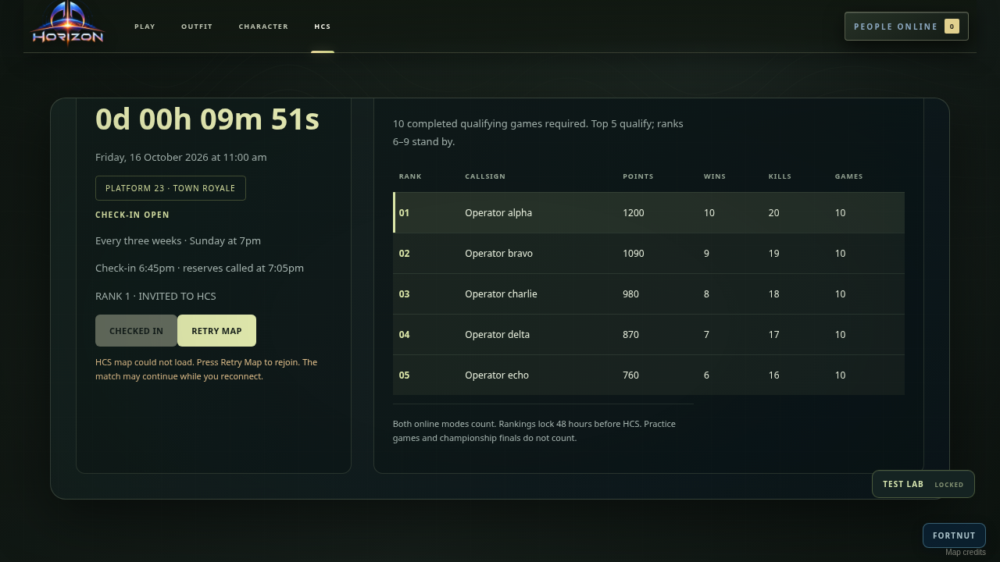
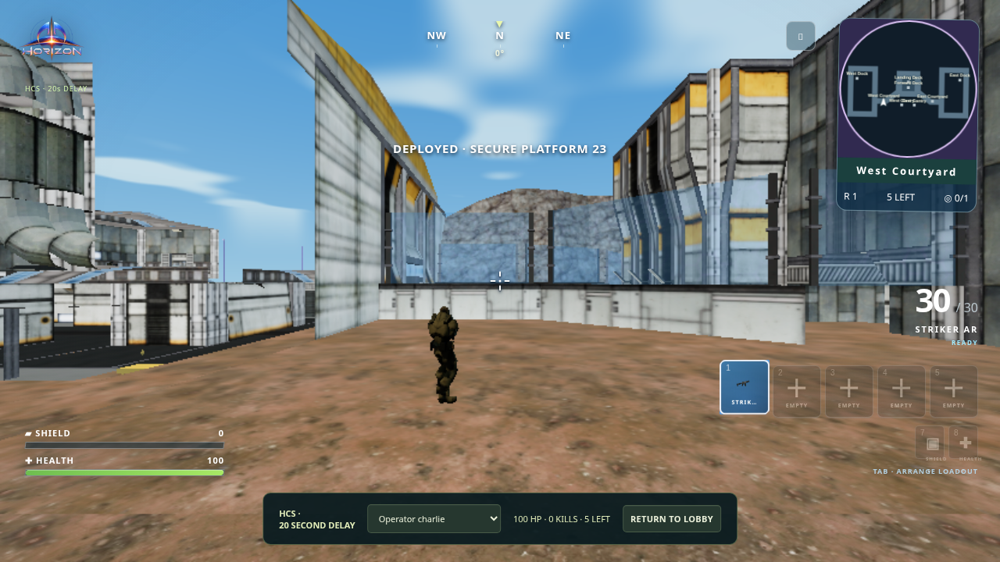

# Horizon release polish — 16 October 2026 (Sydney)

The main polish checkpoint is `c9e681d`, based on `cbb3508`; the follow-up commit adds the finalist Watch guard and this verification record. This pass preserves the existing weapon calibration, damage balance, maps, audio clips and cinematic timing while fixing reproduced UI and recovery problems.

## Changes

- HCS map failures now open the HCS tab with **Retry Map**. Failed downloads are not restarted by every snapshot. Retry uses the newest state of the same final; the server match continues while loading. Leaving, socket replacement or switching to another match discards stale successes and failures. Ordinary-match takeover also clears the old final error.
- A finalist recovering from a failed map cannot accidentally enter spectator mode through **Watch HCS**. The action is hidden and its handler rejects stale clicks, preserving competitive input.
- Rejoining a broadcast now keeps the competitor selector aligned with the actual camera. Unchanged rosters preserve their option nodes.
- Space and Enter retain native activation on focused buttons and expandable controls. Inventory keyboard controls and gameplay inputs remain intact.
- Stable reload status, interaction text, camera/quality attributes and HCS broadcast labels avoid redundant per-frame DOM writes. The browser regression observes **zero** status mutations across five settled frames and zero label mutations across 60 HCS render calls. These checks measure removed UI work, not an FPS increase.
- The local preview serves SVG artwork as `image/svg+xml`, fixing the missing military crest and contour background. HTTP tests check both SVGs plus representative game assets.
- Platform 23 describes the round mode as **Gun skirmish · rounds & eliminations**; Ironwood retains **Build skirmish · harvest & build**. Mode IDs and the existing gun-only/building rules are unchanged.

The previous cloud restart restored an earlier snapshot and removed uncommitted files and captures. The fixes were reconstructed from the recorded changes, their original failures were reproduced again, and fresh verification was run. The interrupted eight-browser stress run is not counted as passing.

## Verification

`npm run check`: **559 tests passed, zero failures/skips**, plus syntax validation and the production build. This includes authoritative two- and eight-player WebSocket tests across both maps and both modes. The restored implementation also passed independent code review with no remaining findings.

The HCS client regression covers the finalist Watch guard, selector consistency, elimination, reconnects, cancelled loads, failed-map retry, newest snapshots, unchanged labels, and both settled and late failures after ordinary-match takeover. The live referee check additionally exercises authenticated check-in, five native players, an injected load failure and recovery into the same final, separate delayed spectating, five selectable competitors and return to the lobby.

**Final result: all 20 browser suites below passed**, with the final targeted reruns replacing the two initial failures. See the [final run summary](reports/final-browser-summary.json), [unit/syntax/build log](reports/unit-syntax-build.log) and [HCS client regression log](reports/hcs-client.log).

### Fresh browser coverage

| Area | Evidence |
| --- | --- |
| Crosshair, compass, live sniper range and stable HUD | [6 checks](reports/aim-hud.json) |
| Live HCS referee, five competitors, map retry and delayed broadcast | [7 checks](reports/hcs-live.json) |
| HCS service and broadcast UI | [6 checks](reports/hcs-ux.json) |
| Two-player multiplayer across both maps and both modes | [8 checks](reports/multiplayer-matrix.json) |
| Lobby layout, native keyboard controls, mobile and 2/4/8 operators | [5 checks](reports/lobby.json) |
| Eight first-person weapons: idle, walk, run and ADS | [32 actual renders](reports/weapon-states.json) |
| Eight remote weapons: 8 poses, front and side | [128 actual renders](reports/remote-poses.json) |
| Full-hand salute, including held pose and palm orientation | [5 poses](reports/salute.json) |
| Six outfit colors, persistence and remote teammate appearance | [5 checks](reports/outfits.json) |
| Exact crosshair pickup and rejection without a visible target | [16 weapon/map combinations](reports/pickups.json) |
| Variant equip/fire, one-shot sound, magazine reload, drop and slot swap over two clients | [9 checks](reports/weapon-variants.json) |
| Inventory, keyboard movement, networked chest/reload, building | [22 checks](reports/controls-inventory-building.json) |
| Native deployment sound, continuous playback and fades | [44.1/48 kHz captures](reports/deployment-audio.json) |
| Native HCS return music and fade | [44.1/48 kHz captures](reports/hcs-victory-audio.json) |
| Return-pod launch, docking, weapon-free salute and cleanup | [11 checks/stages](reports/hcs-victory-stages.json) |
| Full ship-to-combat-to-champion HCS test with two delayed audiences | [6 checks](reports/hcs-full-test.json) |
| Map HTTP outages, retries and both peers reaching the actual map | [7 checks](reports/map-loading-recovery.json) |
| Leave/rejoin during asset loading and stale-party cancellation | [7 checks](reports/map-loading-cancellation.json) |
| Native Platform 23 deployment, floors, collision, gun-only controls, slides and chests | [23 checks](reports/platform23.json) |
| Local eight-operator combat, five-player HCS and delayed viewing test tools | [13 checks](reports/test-lab.json) |
| Two/eight authoritative competitors on both maps/modes | [8 WebSocket tests](reports/two-eight-player-sockets.log) |

The multiplayer matrix injects ordered 60–220 ms snapshot jitter and exercises reconnect, focus loss, sprint release, inventory operations and return/rematch. All four combinations recorded **zero movement jumps**, stable HUD/score nodes and **zero social database reads during active play**. These are assertions over the sampled test, not a guarantee against all internet conditions.

On this software-rendered host, match preparation measured 15.2 s for the first facility load, 3.3 s for the warm facility run, and 5.5/4.2 s for the island runs. The map-status renderer counter currently reports the last facility pass even during island play, so it is not an island geometry benchmark. The full HCS return observed the held salute at song time 25.824 s against the 25.580 s cue, with a 329.5 ms sampled frame gap and peak punch of 1; see [raw timing](reports/hcs-return-salute-sync.json). This is a software-GPU measurement with finite frame resolution.

### Reproduction and initial failures

Run `npm ci`, start `PORT=4182 npm run dev`, then run `npm run check`. Browser scripts use `GAME_TEST_URL=http://127.0.0.1:4182`, `CHROMIUM_EXECUTABLE=/usr/bin/chromium` and a separate `GAME_ARTIFACTS` directory for each invocation. Run the browser commands sequentially on a software GPU. Some older cinematic/test-lab scripts still use port 4173, so start an additional source preview there for those scripts.

The [initial browser summary](reports/initial-browser-summary.json) retains both initial failures. The Platform 23 script asserted a short salute stage after screenshot work had advanced beyond it; it now reads the native frame recorded at the cue, preserving the visibility, input-lock and pose assertions. The [original assertion log](reports/initial-cinematic-assertion.log) is retained. The weapon-variant test [timed out once](reports/initial-variant-timeout.log); an instrumented rerun passed all nine checks. The final script explicitly waits for the asynchronous native pointer-lock capture after Resume before sending the same short firing press. The final rerun passed all nine checks; the first timeout was not captured with enough diagnostics to establish its exact cause. No firing, grip or cinematic implementation was changed to make these tests pass.

### Visual review

These contact sheets contain actual renders, resized and labelled for comparison. They are not generated concept images. The isolated weapon fixtures do not include the engine's sniper scope overlay; the separate live-scope capture does.

- [All first-person weapon states](screenshots/weapon-states.png)
- [Remote poses, front](screenshots/remote-poses-front.png) and [side](screenshots/remote-poses-side.png)
- [Local eight-operator combat test](screenshots/eight-player-local-test.png)
- [Eight-operator lobby](screenshots/lobby-eight.png), [character tab](screenshots/lobby-character.png) and [phone layout](screenshots/lobby-phone.png)
- [Live scope](screenshots/live-scope.png), [full-hand salute](screenshots/salute-palm.png) and [HCS return salute](screenshots/hcs-victory-salute.png)
- [Platform 23 whole map](screenshots/platform23-whole-map.png), [deck](screenshots/platform23-deck.png), [room](screenshots/platform23-room.png) and [upright chest](screenshots/upright-chest.png)
- [Platform 23 gameplay](screenshots/platform23-gameplay.png) and [recoverable map outage](screenshots/map-outage-recovery.png)
- [HCS deployment emblem](screenshots/hcs-emblem.png), [championship screen](screenshots/hcs-full-champion.png) and [delayed audience result](screenshots/hcs-delayed-champion.png)

### HCS recovery and delayed viewing

These are actual browser renders using a local referee, controlled identities and a deliberately shifted fixture schedule. They do not change the production tournament date.

## Test boundaries

This cloud host uses Chromium's **SwiftShader software GPU**, not Apple M3 graphics. Map navigation captures explicitly select low graphics to keep the software-rendered tests practical; they do not represent high settings on an M3. Multiple pages share one machine. Frame timings here are functional diagnostics, not a hardware FPS guarantee. Browser tests use local transport/referee sockets with controlled authentication/database responses; bots and audience windows are test participants, not remote humans. Production Northflank/Supabase latency, real internet behavior, microphone permissions and current M3 Chrome performance were not measured here.

The live HCS browser check renders one competitor and one spectator; four additional competitors use native WebSocket clients. The full HCS test lab uses one local player, four bots and two local audience windows.

The separate eight-browser full-map stress run was interrupted by the earlier environment outage. It is not evidence of either a successful eight-human internet session or a diagnosed game defect. The fresh suite verifies eight connected WebSocket competitors, the lobby check verifies eight native operators, and the test lab renders one local eight-operator bot match. This is not eight independent human clients over the internet.

Only selected captures are checked into this directory. Full fresh outputs are under `/workspace/fortmulti-artifacts/release-polish-2026-10-16`.

No database migration, new dependency or environment variable is required. Players receive the change after the website finishes deploying the new main commit.
