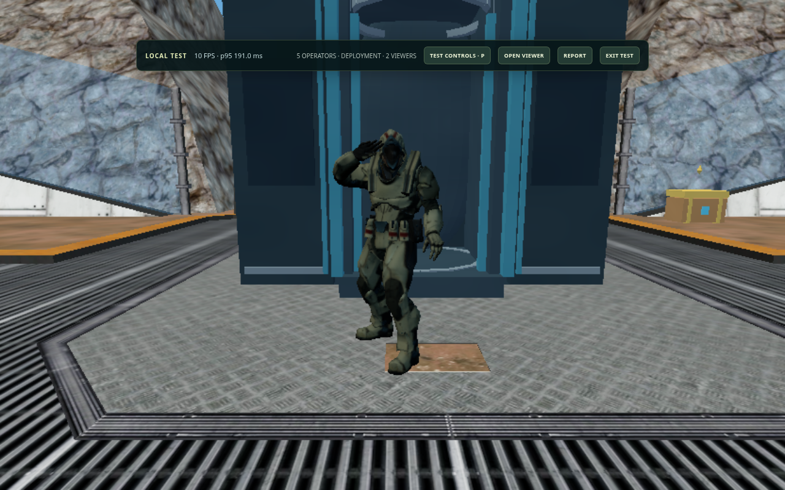

# Deployment salute beat synchronization — 14 October 2026

> Superseded on 15 October: this report records the mistaken start-game deployment change. That sequence was restored to its previous behavior. The requested **HCS winner pod return** is documented in [the corrected report](../hcs-return-beat-2026-10-15/README.md). These captures remain historical evidence.

The pod lands and the operator walks out early enough to reach the full whole-hand salute on **“Big” at 25.580 seconds**, holding through **“stepper” at 25.770 seconds**. A camera push starts on the bass hit at 25.285 seconds, stays close through the lyric, and eases back. The original song continues forward, with the existing 400 ms fade and gameplay handoff at 29.835 seconds.

| Song time | Deployment action |
| --- | --- |
| 22.830 s | Sealed pod touches down; physical debris and landing shake |
| 23.280 s | Hatch begins opening |
| 23.980 s | Operator begins the 1.4-second walkout |
| 25.285 s | Salute camera push begins |
| 25.380 s | 200 ms whole-hand salute raise begins |
| 25.580 s | Full palm pose on “Big” |
| 25.770 s | Full salute and close shot held through “stepper” |
| 29.835 s | Music finishes fading and gameplay unlocks |

The authoritative simulation and locally clocked character rendering share the same salute function. Camera framing adapts to actual terrain-constrained distance and portrait viewports; reduced-motion mode suppresses the camera punch. Weapon mechanics, maps, music assets, multiplayer configuration and the separate HCS victory choreography were left intact.

## Actual captures

[HCS deployment salute](hcs-salute.png) · [Ironwood beat salute](07-beat-salute.png) · [Desktop framing](salute-desktop.png) · [Portrait framing](salute-portrait.png) · [Native palm close-up](palm-close.png)



## Verification

- `npm run check`: 541 tests pass, no failures; syntax validation and production build pass.
- Two native browser clients on Ironwood: the full deployment, one continuous original-song source per client, held salute, camera punch, safe handoff and gameplay controls are checked. See [full results](deployment-browser-results.json) and [timing measurements](timing-summary.json).
- Platform 23: 24 checks pass, including native map rendering, boarding, deployment, the lyric salute, chest opening, crosshair pickup, shooting and local/remote weapon audio. See [results](platform23-results.json).
- Full local HCS test: one browser-controlled operator and four bots, two audience windows with the real 20-second delay, combat, existing victory sequence, delayed championship result, return to lobby and HCS rule checks. All six grouped checks pass without browser exceptions. See [results](hcs-full-results.json).
- Actual Soldier model framing: desktop, compact, ultrawide and portrait viewports; hatch opening, walkout, full salute and camera return. The native projected model bounds retain margin. See [results](framing-results.json).
- Native whole-hand rig: raised palm, close-up, left/right headings and intermediate raise all pass. See [hand results](hand-results.json).
- Native audio rendering: ten cases at 44.1/48 kHz, including late final-fade recovery. Maximum difference from the decoded original forward playback is 5.37e-8, peak amplitude stays below 0.71, and output is silent after handoff. See [audio results](native-audio-results.json).

## Measurement limits and observed stalls

These browser checks use Chromium with software GPU rendering in the cloud, not the player's Apple M3 GPU. They validate the actual models, pose, camera, audio clock and gameplay paths; they do not establish Mac frame rate or internet latency. The local HCS audience transport is BroadcastChannel, not a production Northflank/Supabase match.

Initial Platform 23 runs exposed roughly one-second render stalls on the host client, which could miss the original very short camera accent. Capture-free timing runs showed that capture readback alone was not the cause. Holding the accent through “stepper” makes it visible on the next rendered frame. The final Platform 23 run still recorded the host's first full salute about 329 ms after the measured lyric versus 42 ms for its peer. The native check verifies that the pose appears within the actual presented-frame interval; it does not conceal that hardware delay. [Investigation measurements](platform23-investigation.json) retain the earlier failed timing checks. Fixed-time unit tests independently verify the exact intended pose and cue timing.

Lyric measurements retain the original approximately 80 ms source-alignment uncertainty. Offline audio comparison tests continuity and fades; it is not a recording from physical speakers. Vercel and Northflank production deployment status was not checked from this environment. Both must deploy the same main revision because the deployment timing is shared with the server.

## Reproduce

Run the local server on port 4173. Supply `GAME_TEST_URL=http://127.0.0.1:4173` for browser scripts whose defaults use another port, and `GAME_ARTIFACTS` for the output directory.

```sh
npm run check
node scripts/deployment-cinematic-check.mjs
node scripts/deployment-framing-check.mjs
GAME_TEST_CAPTURE=0 node scripts/platform23-browser-check.mjs
node scripts/full-hand-salute-check.mjs
node scripts/deployment-audio-check.mjs
node scripts/hcs-full-test-check.mjs
```

The deployment recording script additionally requires Playwright's FFmpeg executable. The audio asset and runtime audio player are unchanged.
